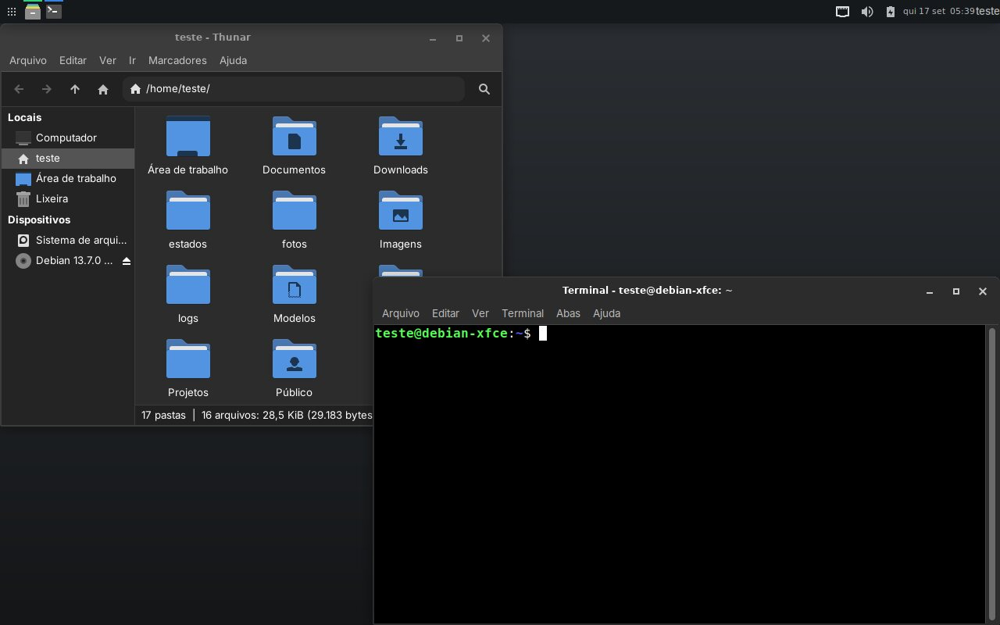
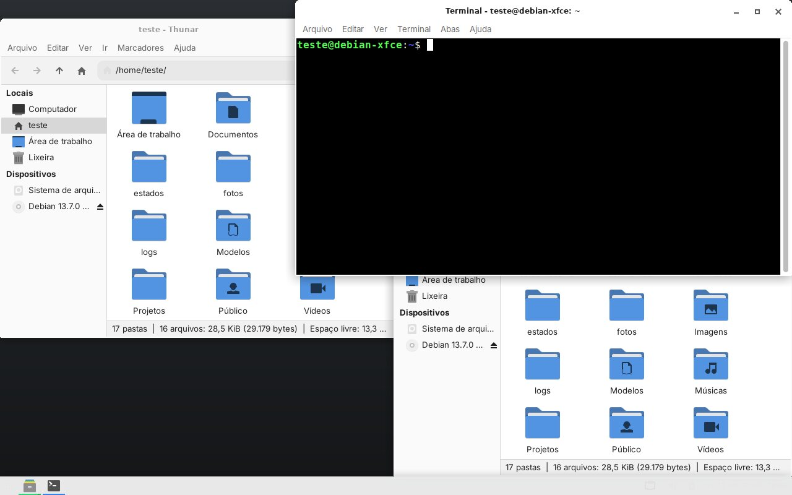
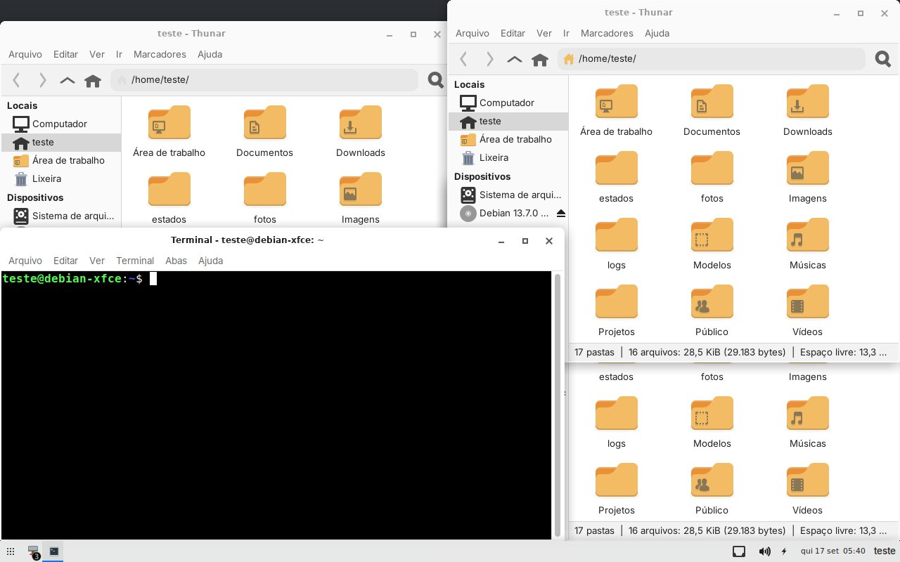
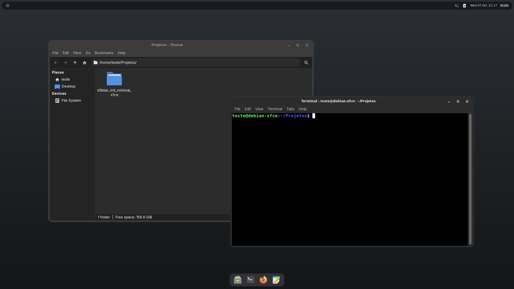
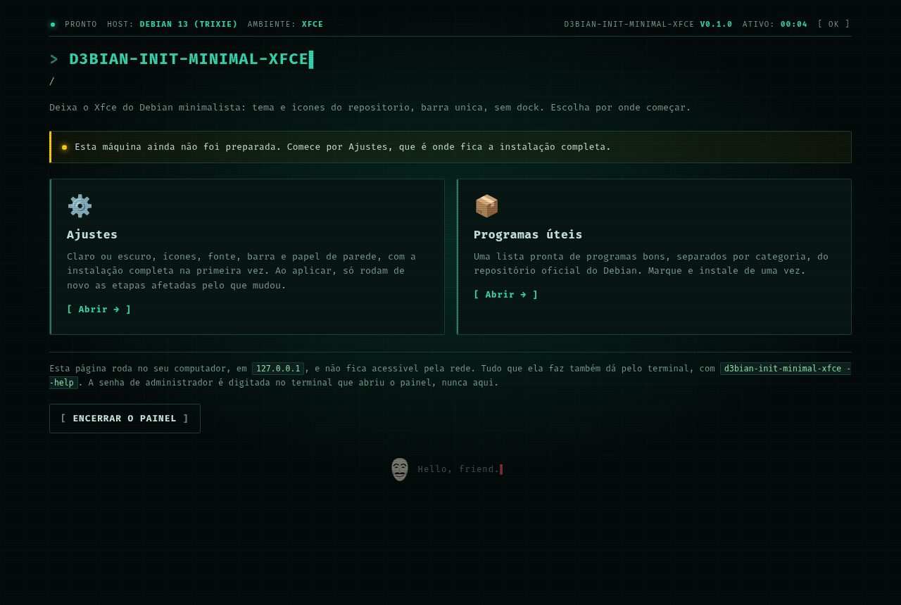
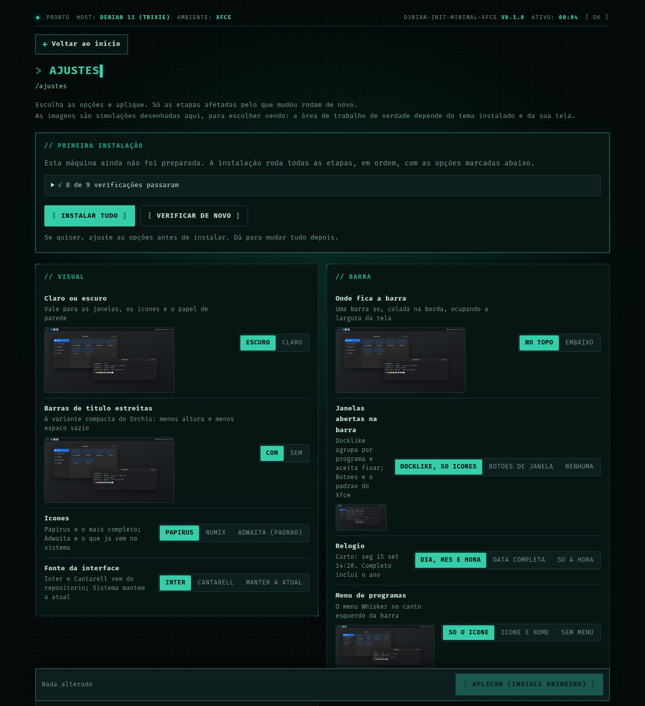
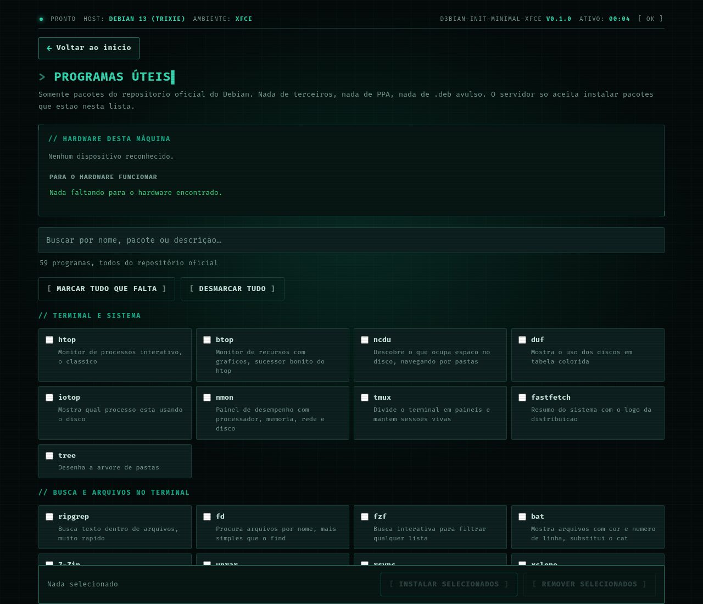
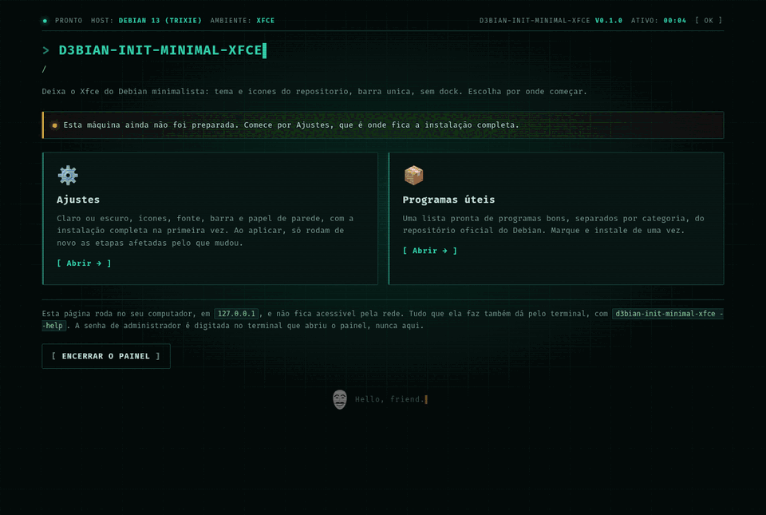

<div align="center">


**O Xfce do Debian minimalista, só com o que vem no repositório: Orchis, Papirus e uma barra só.**

[](docs/desenvolvimento.md)
[](docs/desenvolvimento.md)
[](docs/uso.md#sistemas)
[](docs/uso.md#sistemas)
[](LICENSE)

</div>

> Um painel local, aberto no navegador, que deixa o Xfce do Debian minimalista
> usando **só o que vem no repositório**: nada é clonado nem compilado, e por isso
> o desfazer é simples. Só Python da biblioteca padrão — nada de pip.

```sh
git clone https://github.com/diego-luz/minimal-xfce.git d3bian_init_minimal_xfce
python3 -m d3bian_init_minimal_xfce        # pede a senha uma vez e abre o painel
```

<div align="center">
  
</div>

<details>
<summary><b>In English</b></summary>

A local control panel, opened in your browser, that makes Xfce on Debian
**minimal, using only what is in the repository**: Orchis theme, Papirus icons,
Inter font, a single top bar with grouped window icons, a clean desktop and a plain
or gradient wallpaper drawn on the fly. Optional island-style panels and picom
effects.

- **Official Debian packages only**: nothing is cloned, downloaded or compiled.
- **Safe to try**: every change is backed up and journaled; *Restore* puts your
  desktop back the way it was.
- **Python standard library only**: no pip, nothing to build.

```sh
git clone https://github.com/diego-luz/minimal-xfce.git d3bian_init_minimal_xfce
python3 -m d3bian_init_minimal_xfce        # asks for your password once, opens the panel
```

The interface and the documentation are in Brazilian Portuguese.

</details>

---

## O que ele faz

- **Tema** Orchis (pacote `orchis-gtk-theme`), claro ou escuro, com a variante
  compacta para barras de título estreitas
- **Ícones** Papirus, Numix ou os Adwaita que já vêm no sistema
- **Fonte** Inter ou Cantarell, também do repositório
- **Barra única no topo**, sem dock: menu só com ícone, janelas abertas no
  `xfce4-docklike-plugin` (ícones agrupados, sem texto), relógio e bandeja
- **Área de trabalho** sem ícones, com papel de parede liso ou em degradê
  desenhado na hora pelo ImageMagick, em tons discretos
- **Encaixe de janelas** por atalho, bordas mais largas, e nova janela e nova aba no clique direito do terminal
- **Barra em ilhas**, se quiser: barra fina solta no topo e as janelas abertas numa
  ilha embaixo, com cantos redondos (vinda do [oasis-xfce](https://github.com/diego-luz/oasis-xfce))
- **Efeitos com o picom**, se quiser: sombras, cantos redondos e desfoque, em modo
  leve onde não há aceleração de vídeo
- **Programas úteis**: uma lista pronta do repositório oficial do Debian, conforme o hardware

<!-- imagens: gerado a partir do teste num Debian 13; refazer, nao editar a mao -->
## Telas

| Com outras opções da página | Mais uma combinação de opções |
|---|---|
|  |  |

| Barra em ilhas, com o picom (`barra = ilhas`, `efeitos = desfoque`) |
|---|
|  |

| Início | Opções | Programas úteis |
|---|---|---|
|  |  |  |

<details>
<summary><b>A instalação pela página, do começo ao resultado</b></summary>



</details>
<!-- fim imagens -->

## Documentação

| | |
|---|---|
| 🚀 [Usando](docs/uso.md) | rodar, opções, o que fica onde, sistemas, voltar ao que era antes |
| 🛠️ [Desenvolvimento](docs/desenvolvimento.md) | receitas, como as imagens de exemplo são geradas |
| ⚙️ [Núcleo](docs/nucleo.md) | o motor, o servidor e as telas comuns a toda a família |

## Família d3bian-init

Todos com o mesmo motor e o mesmo jeito de usar: um painel local, só Python da biblioteca padrão, e "voltar ao que era antes".

| | Projeto | O que faz |
|---|---|---|
| 🪟 | [bigsur-xfce](https://github.com/diego-luz/bigsur-xfce) · [bigsur-minimalista-xfce](https://github.com/diego-luz/bigsur-minimalista-xfce) | Cara de macOS Big Sur no Xfce, completo ou minimalista |
| 🪟 | **minimal-xfce** · [paleta-xfce](https://github.com/diego-luz/paleta-xfce) | Xfce enxuto, ou numa paleta só (Nord, Gruvbox, Everforest) |
| 🪟 | [oasis-xfce](https://github.com/diego-luz/oasis-xfce) | Xfce em ilhas, com desfoque do picom, grade no rofi e dunas, só com o repositório |

Os temas Xfce (🪟) são um por conta: com outro instalado, a instalação é recusada, e `aplicar --trocar` (ou o botão no painel) volta o outro e instala este ([detalhes](docs/uso.md#um-tema-xfce-por-vez)).

## Créditos

- O visual segue o que aparece nas montagens minimalistas de Xfce que circulam por aí —
  [esta do Diolinux Plus](https://plus.diolinux.com.br/t/void-xfce-minimalista/74056),
  por exemplo, usa Orchis Dark com Papirus Dark, a mesma dupla deste projeto, ambas no
  repositório do Debian.
- Tudo é instalado do repositório oficial do Debian, cada um com a sua licença:
  [Orchis](https://github.com/vinceliuice/Orchis-theme) (GPL-3.0),
  [Papirus](https://github.com/PapirusDevelopmentTeam/papirus-icon-theme) (GPL-3.0),
  [Numix](https://github.com/numixproject/numix-icon-theme) (GPL-3.0), as fontes
  [Inter](https://rsms.me/inter/) e [Cantarell](https://gitlab.gnome.org/GNOME/cantarell-fonts)
  (SIL OFL) e o [docklike](https://docs.xfce.org/panel-plugins/xfce4-docklike-plugin/start).
  O repositório não traz nenhum deles.

---

<div align="center">
<sub>Código sob a <a href="LICENSE">licença MIT</a> · feito para o Debian 13</sub>
</div>
